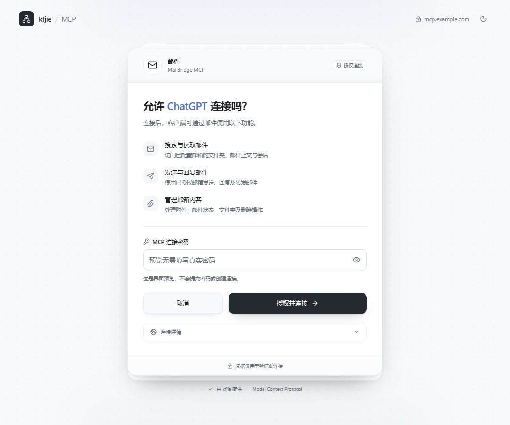
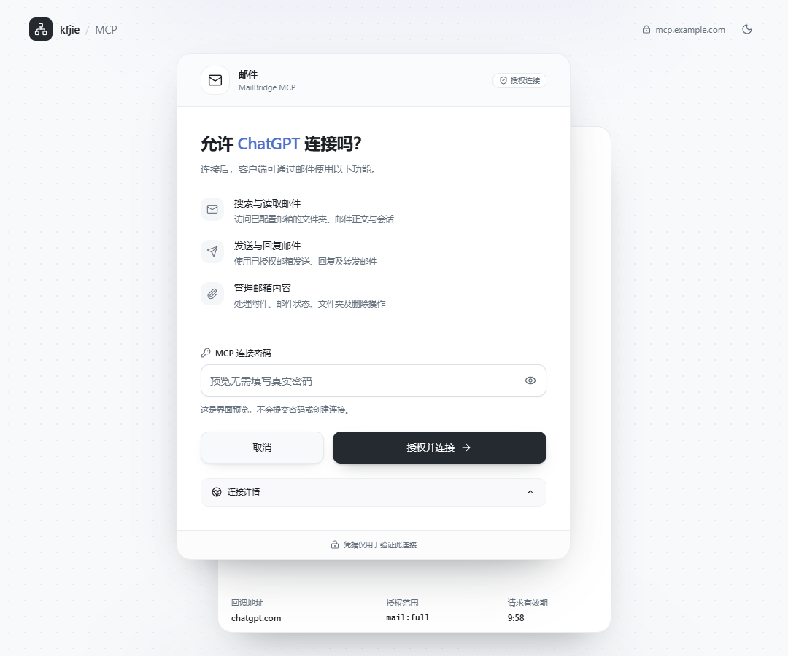
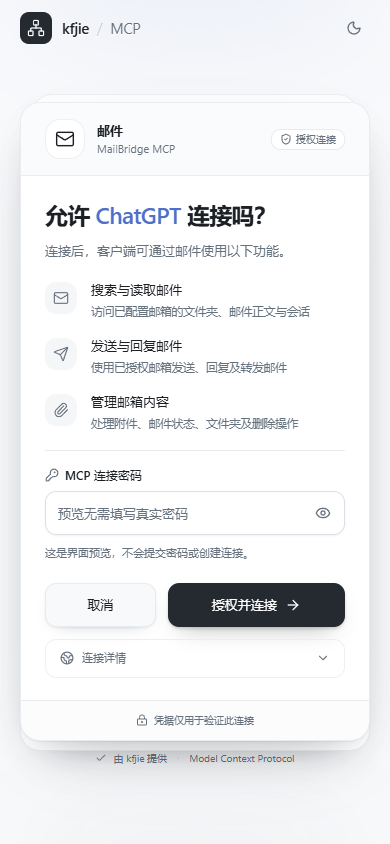

# MCP Auth UI

面向 MCP 服务的 OAuth 授权页面，使用 React、Next.js、shadcn/ui 和 Tailwind CSS。

<picture>
  <source media="(prefers-color-scheme: dark)" srcset="docs/images/dark.png">
  
</picture>

## 交互

- 浅色与深色模式，适配桌面和手机。
- 点击连接详情，上下两层卡片滑动展开。
- 密码显隐、授权提交、错误重试和请求过期状态。
- JavaScript 不可用时提供原生表单。

| 详情展开 | 手机布局 |
| --- | --- |
|  |  |

展示图来自示例预览，域名为占位值。

## 本地预览

需要 Node.js 24+。

```bash
git clone https://github.com/Kfjie-MCP/auth-ui.git
cd auth-ui
npm ci
npm run build
npm run preview
```

打开 `http://127.0.0.1:3180/auth-ui/preview/mailbridge/`。还可将 `mailbridge` 换成 `agent-reach`、`transcriptor` 或 `xuexitong`，使用 `?theme=dark`、`?state=error`、`?state=expired` 查看其他状态。

预览不会提交密码。线上页面显示当前访问域名，项目中不保存实际服务地址。

## 接入

网关通过 `server/render.mjs` 注入服务、客户端和请求信息。账号验证、PKCE 和令牌处理由网关负责。部署与调用方式见[接入说明](docs/deployment.md)。

开发检查：`npm run typecheck`。组件来源和许可证见 [THIRD_PARTY_NOTICES.md](THIRD_PARTY_NOTICES.md)。
